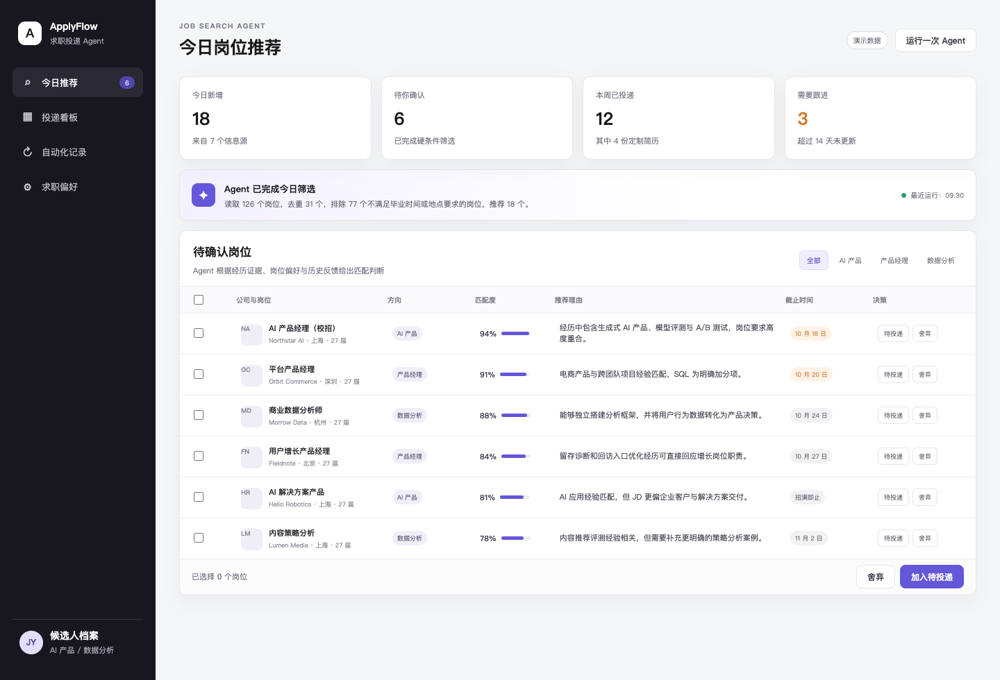

# ApplyFlow | 求职投递 Agent

一个基于 Codex 工作流设计的网页端求职工作台 Demo，用于呈现岗位发现、匹配决策、简历适配、申请执行与后续跟进的完整结构。

> 本项目使用演示数据，重点展示产品信息架构与关键交互，不连接真实招聘网站或个人账号。

## 核心功能

1. **Agent 岗位推荐**：增量整理多源岗位，完成去重与硬条件筛选，并结合候选人经历、求职偏好和历史反馈输出匹配度与推荐理由。
2. **批量人工决策**：候选人可以批量选择“待投递”或“舍弃”，决策结果会成为后续推荐排序的反馈信号。
3. **申请自动化**：为确认投递的岗位选择简历版本并生成修改 Diff，衔接浏览器辅助填写与最终人工确认。
4. **持续跟进**：集中记录投递结果、测评和面试节点，并定期检查长期未更新的申请。

## 页面结构

- 今日推荐：岗位匹配、推荐理由、截止时间与批量决策
- 投递看板：待准备、网申中、已投递、后续节点
- 自动化记录：岗位扫描、反馈学习、简历适配、状态检查与飞书同步
- 求职偏好：目标方向、城市、排除条件与文字反馈

## 技术栈

HTML + CSS + JavaScript；Codex 负责任务编排与 Agent 工作流设计；飞书作为结构化数据与进度同步端；浏览器操作用于辅助网申。

## 本地运行

直接打开 `index.html`，或在项目目录运行：

```bash
python3 -m http.server 4173
```

然后访问 `http://localhost:4173`。

## 截图


